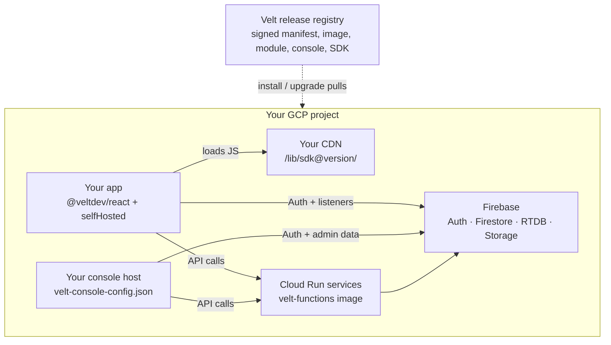

You don't run this deployment by hand. An AI coding agent follows the [Install guide](/self-hosting/full/gcp/install) and stops to ask you whenever a step needs a person.

Budget 2 to 5 hours of wall clock time. Most of it is waiting on Terraform and Firestore index creation, not typing.

<Note>
  New to full self-hosting? Read the [Overview](/self-hosting/full/overview) first.
</Note>

## What runs in your project

| Piece | What you run |
| --- | --- |
| **Backend** | Velt's signed container, deployed as Cloud Run services by Velt's signed Terraform module |
| **Data and sign-in** | Your own Firebase project: Auth, Firestore, Realtime Database, and Storage |
| **Console** | The Velt admin console as static files on a host you choose |
| **SDK** | The Velt client SDK files on your CDN |
| **First workspace** | A workspace, API keys, and console admins, seeded by the agent |



<Steps titleSize="h2">

<Step title="Check the prerequisites">

- A GCP project you can administer (or create), with a billing account you can link.
- Permission to create a Google OAuth client for console sign-in.
- A static host for the console and a CDN for the SDK. If you have neither, the agent can use Firebase Hosting in the same project.
- Your own Gemini and Anthropic API keys.
- Someone available to run an AI coding agent for the duration.

**Tools on the machine that runs the agent:** `gcloud`, the `firebase` CLI, Terraform 1.5+, `oras`, `cosign`, Node 20+, Docker, `curl`, `python3`, and `jq`. The agent checks versions before it starts and stops if anything is missing.

</Step>

<Step title="Decide your inputs">

Decide these once, up front. The agent asks for all of them before it starts.

| Input | Meaning |
| --- | --- |
| `PROJECT_ID` / `REGION` | Where Cloud Run and Firebase live (`us-central1` recommended) |
| `PROFILE` + `OPT_IN_MODULES` | Which features to deploy. See [Deployment profiles](/self-hosting/full/gcp/reference#deployment-profiles) |
| `OWNER_EMAIL` / `WORKSPACE_NAME` / admin emails | The workspace owner and console admins |
| `APP_DOMAINS` | The domains your app runs on |
| Console host and `CONSOLE_BASE` | Where the console is served from |
| SDK host and `CDN_BASE` | Where the SDK files are served from |
| `GOOGLE_GEN_AI_API_KEY` / `ANTHROPIC_API_KEY` | Your own LLM keys |

<Warning>
  The Gemini and Anthropic keys are **required even on the `core` profile**. Memory embeddings and knowledge search run on Gemini; agent paths use Anthropic. Placeholder values pass the install and then fail at runtime.
</Warning>

<Tip>
  Using a custom hostname for the console or SDK? Confirm now that someone can add a DNS record for it within the hour. It is the most common cause of a stalled install.
</Tip>

</Step>

<Step title="Start your agent">

Copy the agent instructions from the [Install guide](/self-hosting/full/gcp/install) and paste them into your AI coding agent. Then start it with a prompt like this, filled in with your inputs:

```text
You are deploying Velt full self-hosting into our own GCP project.

Follow the Velt Install Guide (GCP) I gave you, phase by phase. Do not
invent your own procedure. When a field shape is unclear, check the Velt
full self-hosting Reference page.

Inputs:
  PROJECT_ID      = <your-gcp-project-id>
  REGION          = us-central1
  PROFILE         = core
  OPT_IN_MODULES  =
  OWNER_EMAIL     = <admin@example.com>
  WORKSPACE_NAME  = <Acme Inc>
  APP_DOMAINS     = <app.example.com>
  CONSOLE_BASE    = <https origin where the console will be served>
  CDN_BASE        = <https origin where the SDK will be served>

Ask me for the Gemini and Anthropic API keys when you seed secrets.
Maintain velt-selfhost-state.json after every phase so this run can be
resumed in a fresh session. Stop and ask me whenever a step needs a human.
```

The agent ends with a final report: your endpoints, your app's config, and where every secret is stored. Keep `velt-selfhost-state.json`; you need it to upgrade later.

</Step>

<Step title="Stay available for the human steps">

The agent pauses and asks at each of these moments, with the exact command or console link.

| Moment | What you do |
| --- | --- |
| Billing | Link a billing account to the GCP project |
| OAuth client | Create the Google OAuth client for console sign-in (Google doesn't allow this by API) |
| Image scan | Sign off the image scan, if your policy requires one |
| DNS | Add the record, only if you use a custom hostname |
| Sign-in test | Sign in to the console for the first time |

</Step>

<Step title="Wire your app">

Hosting the SDK on your CDN only moves the **code**. Pass the `selfHosted` config the agent generated so the SDK also **talks** only to your deployment.

<Tabs>
  <Tab title="React / Next.js">
  ```jsx
  import selfHosted from './velt-selfhosted-config.json';

  <VeltProvider
    apiKey="<production api key>"
    config={{
      proxyDomain: 'https://static.example.com',  // your CDN origin only
      version: '<sdk-version>',                    // must match the folder on your CDN
      selfHosted,                                  // generated by the agent
    }}
  >
    <App />
  </VeltProvider>
  ```
  </Tab>
  <Tab title="Other Frameworks">
  ```js
  import selfHosted from './velt-selfhosted-config.json';

  const client = await initVelt('<production api key>', {
    proxyDomain: 'https://static.example.com',  // your CDN origin only
    version: '<sdk-version>',                    // must match the folder on your CDN
    selfHosted,                                  // generated by the agent
  });
  ```
  </Tab>
</Tabs>

**Rules that break production if violated:**

1. The SDK lives at exactly `/lib/sdk@<version>/velt.js` on your CDN, with **all** its chunks in the same folder.
2. Every `.js` file sends an `Access-Control-Allow-Origin` header. Missing CORS is the most common failure.
3. Use the generated `selfHosted` file as is. It sets `strict: true` and the exact list of deployed features.
4. Allow your CDN in your Content Security Policy's `script-src`, and remove `cdn.velt.dev` once you cut over.

Field-level shape: [Reference, `selfHosted` config](/self-hosting/full/gcp/reference#sdk-selfhosted-config).

</Step>

<Step title="Confirm it is done">

The deployment is complete only when all four pass:

1. Console sign-in as a seeded admin lands on the dashboard with the workspace and keys.
2. The app loads `velt.js` and its chunks from **your** CDN, and `window.Velt.version` matches the pin.
3. A comment created in the app appears in the console's data browser.
4. The browser's network log for both the app and the console shows **no** requests to `velt.dev` or other Velt-owned hosts.

</Step>

</Steps>

## Troubleshooting your app

| Symptom | Likely cause |
| --- | --- |
| The SDK never loads | Missing CORS headers on the CDN's `.js` files, or the path isn't `/lib/sdk@<version>/velt.js` |
| The SDK loads but data goes to Velt, or features are missing | The `selfHosted` config is missing or edited by hand |
| The console loads but sign-in fails | The OAuth client or authorized domains don't include the console host |
| A hand-built `curl` returns "Api key not found" | Expected. These endpoints need a signed-in user, so test through the app or console |

For infrastructure errors, ask your agent: the agent instructions include the full troubleshooting table.

## Upgrading later

Upgrades are a delta, not a reinstall. Hand your agent the [Upgrade guide](/self-hosting/full/gcp/upgrade) and your `velt-selfhost-state.json`. It compares the new release with the installed one and updates only what changed. Releases don't require data migrations today; if one ever does, its release notes say so.
